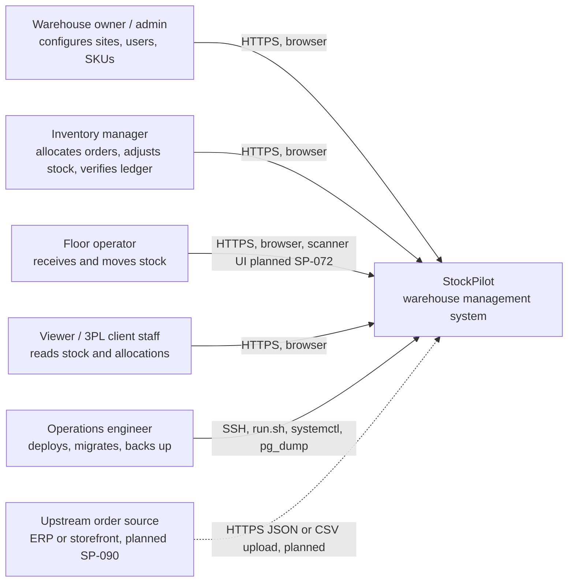
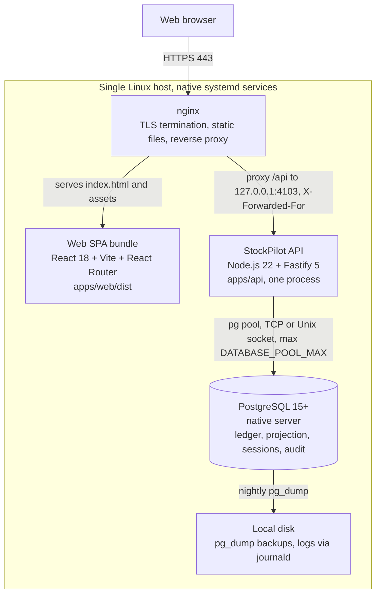
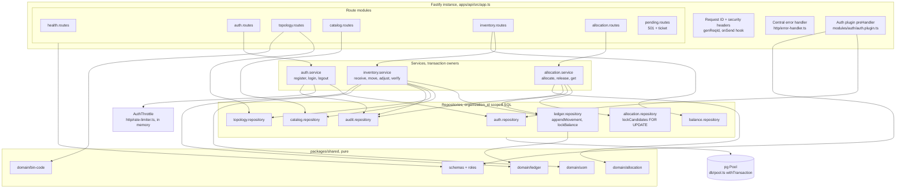
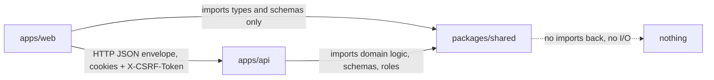
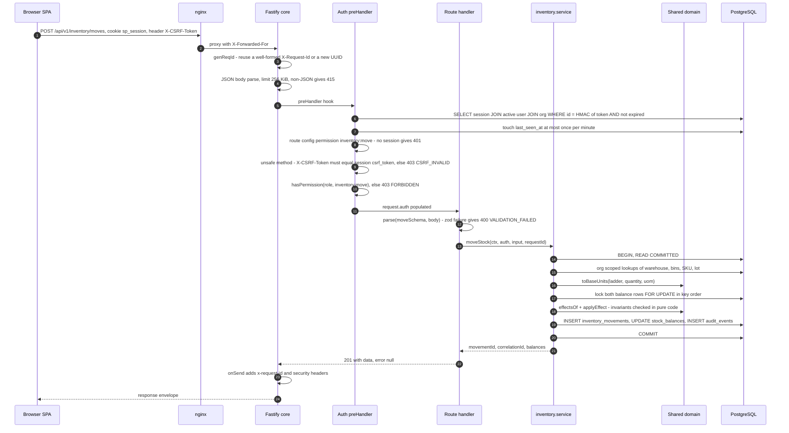
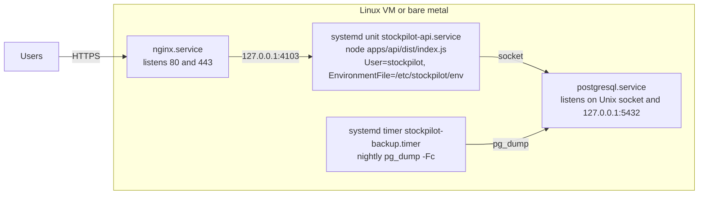

# Architecture overview

StockPilot is a warehouse management system for third-party logistics (3PL) operators and multi-site distribution teams. This document describes the system at three C4 levels (context, container, component), the module boundaries that keep the hard domain logic testable, the lifecycle of one HTTP request, and the deployment shape.

Related documents: [quality attributes](quality-attributes.md), [system design](../design/system-design.md), [data model](../design/data-model.md), [threat model](../security/threat-model.md), [ADR index](../adr/README.md).

## 1. System context (C4 level 1)

StockPilot is self-contained. It makes **no outbound calls at runtime** (ADR-0003): there is no email provider, carrier API, map service, CDN or analytics. Anything that would normally need one is simulated locally — for example, email verification will write to a local outbox table (SP-009, SP-173), and carrier rates come from local rate tables (SP-121).

| Actor             | Role in RBAC (`packages/shared/src/roles.ts`) | Typical permissions                                                   |
| ----------------- | --------------------------------------------- | --------------------------------------------------------------------- |
| Warehouse owner   | `owner`                                       | everything, including `users:manage`                                  |
| Administrator     | `admin`                                       | `topology:write`, `inventory:verify`, `users:manage`                  |
| Inventory manager | `manager`                                     | `allocation:write`, `inventory:adjust`, `catalog:write`, `audit:read` |
| Floor operator    | `operator`                                    | `inventory:receive`, `inventory:move` + read                          |
| Viewer            | `viewer`                                      | `topology:read`, `catalog:read`, `inventory:read`, `allocation:read`  |

## 2. Containers (C4 level 2)

| Container     | Technology                                   | Responsibility                                                                                                                       | Source                                                                                |
| ------------- | -------------------------------------------- | ------------------------------------------------------------------------------------------------------------------------------------ | ------------------------------------------------------------------------------------- |
| Web SPA       | React 18, Vite, TypeScript, plain CSS tokens | Login, navigation (planned sections carry a "Planned" badge and ticket), stock-on-hand by bin, receive/move forms, allocation screen | `apps/web/src`                                                                        |
| API           | Fastify 5, `pg`, `zod`, `pino`               | All business rules, authentication, RBAC, ledger writes, allocation                                                                  | `apps/api/src`                                                                        |
| Shared domain | Pure TypeScript + zod                        | UoM math, ledger fold, allocation engine, bin addressing, schemas, roles                                                             | `packages/shared/src` (a library linked into both API and web, not a runtime process) |
| Database      | PostgreSQL 15+                               | Single source of truth for every piece of state, including sessions                                                                  | `apps/api/migrations/*.sql`                                                           |
| nginx         | nginx from the OS package manager            | TLS, gzip, static SPA, `/api` proxy; the API trusts exactly one hop (`TRUST_PROXY=1`)                                                | see `docs/operations/deployment.md`                                                   |

In development `run.sh dev` starts the API (`tsx watch`) and the Vite dev server; Vite proxies `/api` to `127.0.0.1:4103`, so the browser sees one origin exactly as it does behind nginx.

## 3. Components of the API (C4 level 3)

### Component responsibilities

| Component                                 | Responsibility                                                                                                                                                                                                                                                                                        | Key decisions      |
| ----------------------------------------- | ----------------------------------------------------------------------------------------------------------------------------------------------------------------------------------------------------------------------------------------------------------------------------------------------------- | ------------------ |
| `config/env.ts`                           | Parses `process.env` with zod once at startup; refuses to boot on invalid config, a placeholder `SESSION_SECRET` in production, or an unset `TRUST_PROXY` in production                                                                                                                               | ADR-0004           |
| `http/error-handler.ts`, `http/errors.ts` | Maps `AppError`, `DomainError` and PostgreSQL SQLSTATEs (23505, 23514, 23503, 40P01, 40001) to the envelope                                                                                                                                                                                           | ADR-0005           |
| `http/validate.ts`                        | `parse(schema, input)` turns zod failures into `400 VALIDATION_FAILED` with per-field details                                                                                                                                                                                                         | ADR-0004           |
| `http/rate-limiter.ts`                    | Synchronous reservation of login and registration attempts: per-email progressive backoff, per-IP spraying window, per-IP and per-/48 email fan-out caps, per-IP registration window; normalised IPs; bounded authoritative maps with an overflow count-min sketch for force-evicted active lock-outs | ADR-0006, ADR-0020 |
| `modules/auth`                            | scrypt hashing, HMAC-keyed session IDs, cookie issue/clear, CSRF + permission preHandler                                                                                                                                                                                                              | ADR-0006           |
| `modules/topology`                        | Warehouses (canonical IANA time zone), zones, bins with parsed codes and default pick sequence                                                                                                                                                                                                        | ADR-0013, ADR-0014 |
| `modules/catalog`                         | SKUs with validated nested UoM ladders, lots with `ON CONFLICT` upsert                                                                                                                                                                                                                                | ADR-0008, ADR-0012 |
| `modules/inventory`                       | The only writer of `inventory_movements` and `stock_balances` (`appendMovement`); projection verification                                                                                                                                                                                             | ADR-0009, ADR-0015 |
| `modules/allocation`                      | Locks candidates, calls the pure planner, persists the plan and `ALLOCATE`/`DEALLOCATE` ledger entries                                                                                                                                                                                                | ADR-0010, ADR-0011 |
| `modules/audit`                           | `recordAudit` inside the caller's transaction                                                                                                                                                                                                                                                         | —                  |
| `modules/pending`                         | Registers every not-yet-built endpoint from `pending.catalog.ts`; each answers `501 NOT_IMPLEMENTED` with `details.ticket`                                                                                                                                                                            | ADR-0005           |

## 4. Module boundaries

Rules enforced by convention and code review (an ESLint import-boundary rule is part of SP-183):

1. **`packages/shared` is pure.** It depends only on `zod`. It performs no I/O, reads no clock (callers pass `today`), and returns new frozen or fresh objects. Every hard algorithm lives here and is unit tested with high coverage thresholds (90% lines in `packages/shared/vitest.config.ts`).
2. **API layering is routes -> service -> repository.** Routes parse input and declare a permission; services own transactions and orchestrate; repositories hold SQL and always take `organization_id` (ADR-0016). Simple read-only routes (topology, catalog, balances) call repositories directly.
3. **One writer for the ledger.** Only `ledger.repository.appendMovement` inserts into `inventory_movements` and updates `stock_balances`. Inventory and allocation services both go through it, which guarantees that every on-hand or allocated change has a ledger row (ADR-0009).
4. **Cross-module reuse is explicit.** `allocation.service` reuses `inventory.service.ladderOf/todayIn` and `ledger.repository.appendMovement`; `inventory.service` reuses `catalog.repository` and `topology.routes.requireWarehouse`. No module reaches into another module's tables with its own SQL, except read joins for display.
5. **The web app never re-implements rules.** It uses shared types and formats quantities, but the API is authoritative; all validation is repeated server-side.

## 5. Request lifecycle

Example: `POST /api/v1/inventory/moves` from the stock screen.

Failure paths all converge on the central error handler, so the client always receives `{ data: null, error: { code, message, details? } }`:

| Source                   | Example                                               | HTTP / code                                        |
| ------------------------ | ----------------------------------------------------- | -------------------------------------------------- |
| zod                      | missing `lotId`                                       | 400 `VALIDATION_FAILED`                            |
| `DomainError`            | 18 EA requested as CS of 12                           | 400 `NON_INTEGRAL_CONVERSION`                      |
| `DomainError`            | move more than available                              | 409 `INSUFFICIENT_AVAILABLE`                       |
| PostgreSQL 23514         | `allocated <= on_hand` CHECK fires                    | 409 `CONSTRAINT_VIOLATION`                         |
| PostgreSQL 23505         | second open allocation for the same `order_ref`       | 409 `ALREADY_EXISTS`                               |
| PostgreSQL 40P01 / 40001 | deadlock detected                                     | 503 `CONCURRENCY_RETRY`                            |
| throttles                | sixth login attempt for one email after five failures | 429 `RATE_LIMITED` + `Retry-After`                 |
| pending route            | `GET /api/v1/waves`                                   | 501 `NOT_IMPLEMENTED`, `details.ticket = "SP-092"` |

Errors with status >= 500 are logged at `error` with the stack; 4xx are logged at `info` with only code and status. `pino` redacts the `cookie`, `x-csrf-token` and `set-cookie` headers.

## 6. Deployment shape

StockPilot is deliberately a **single Node.js process + nginx + native PostgreSQL** on one Linux host, all managed by systemd (ADR-0019). There are no containers, orchestrators, queues or caches.

Consequences of this shape:

- **Vertical scaling only, for now.** The authentication throttles are kept in process memory (`http/rate-limiter.ts`). That is correct for exactly one API process. **Before a second API instance is started, the counters must move to PostgreSQL (SP-183 hardening, delivered by the shared throttle store SP-190)**; otherwise an attacker gets N times the attempt budget by spreading requests across instances.
- **Graceful shutdown.** `SIGTERM` closes the Fastify server (draining in-flight requests) and ends the pool; systemd `Restart=on-failure` restarts a crashed process.
- **Readiness** is `GET /api/v1/ready`, which counts `schema_migrations` rows and returns 503 if the database is unreachable or unmigrated. `GET /api/v1/health` is a liveness probe that does not touch the database.
- **Release** is: build on the host or a build box, stop the unit, run `npm run db:migrate` (forward-only, ADR-0007), start the unit. Rollback means redeploying the previous build; schema changes must therefore be backward compatible for one release.

Details (unit files, nginx config, backup and restore commands) live in `docs/operations/deployment.md` and `docs/operations/runbook.md`.
