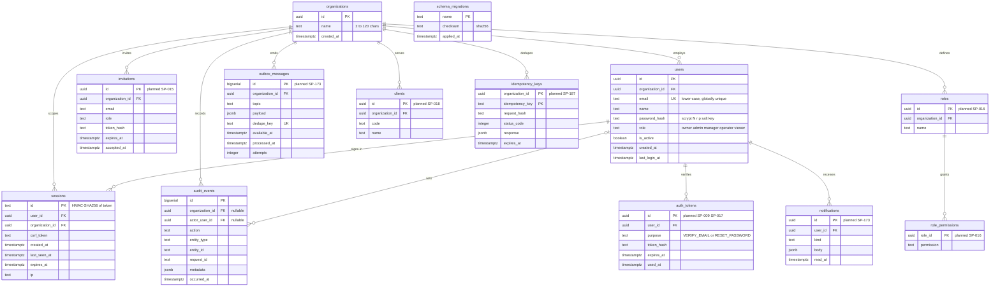
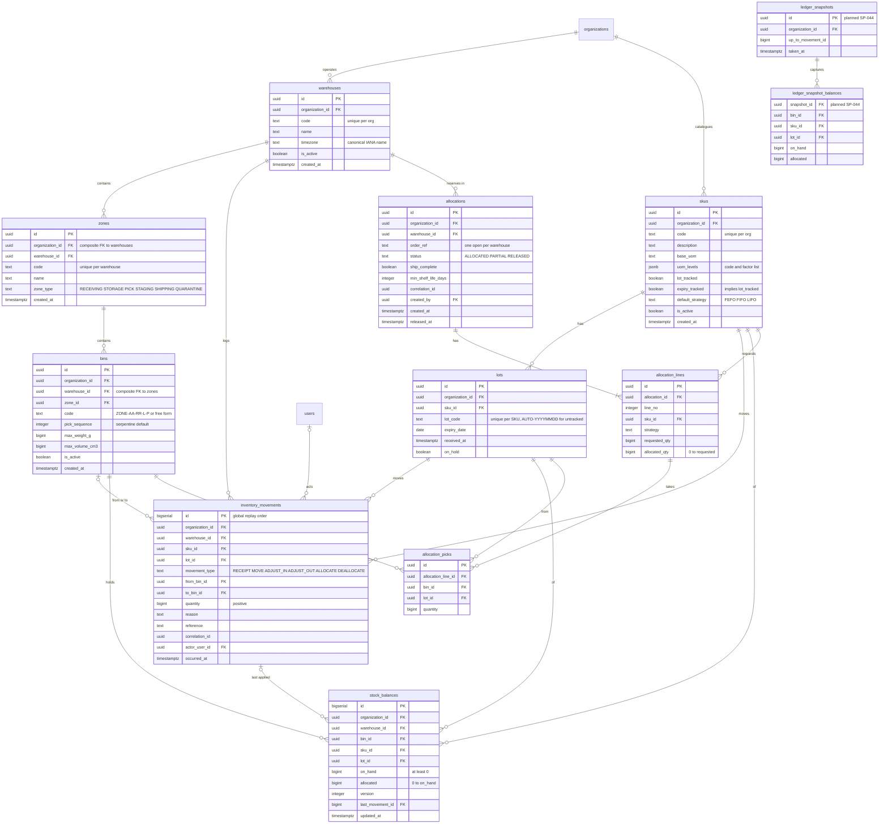
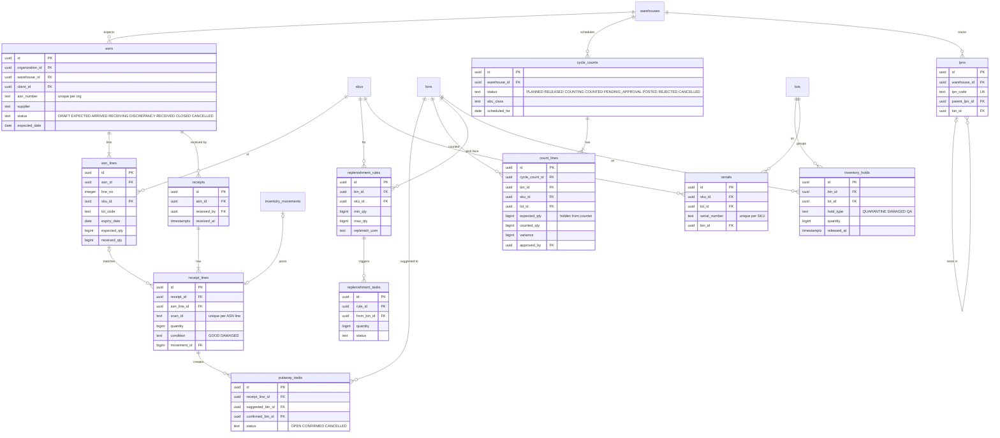
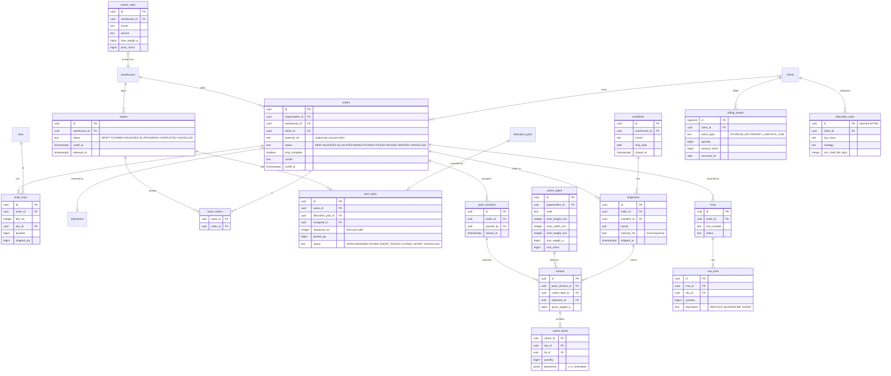

# Data model

The full **target** schema of StockPilot, the part that is migrated today, and the plan for the rest. Conventions:

- Primary keys are `uuid DEFAULT gen_random_uuid()` except high-volume append tables (`inventory_movements`, `stock_balances`, `audit_events`), which use `bigserial` for compact indexes and a global replay order.
- Every tenant-owned table carries `organization_id` (ADR-0016), or is reachable only through a parent that does.
- Quantities are `bigint` counts of the SKU's base unit (ADR-0008), bounded by `MAX_QUANTITY = 10^12`; physical dimensions are integers in grams, millimetres and cubic centimetres.
- Timestamps are `timestamptz` (UTC); calendar dates such as lot expiry are `date` and are parsed as `YYYY-MM-DD` strings, never shifted through a time zone (`db/pool.ts` type parser 1082).
- Codes (warehouse, zone, bin, SKU, UoM) are stored upper-case and unique per parent.
- Migrations are forward-only plain SQL with checksums (ADR-0007).

## 1. Migration status

| Migration                       | Status                | Tables                                                                                                                 | Tickets                        |
| ------------------------------- | --------------------- | ---------------------------------------------------------------------------------------------------------------------- | ------------------------------ |
| (runner)                        | applied automatically | `schema_migrations`                                                                                                    | SP-004                         |
| `0001_foundation.sql`           | **exists**            | `organizations`, `users`, `sessions`, `audit_events`                                                                   | SP-004, SP-010, SP-011, SP-014 |
| `0002_topology_catalog.sql`     | **exists**            | `warehouses`, `zones`, `bins`, `skus`, `lots`                                                                          | SP-020, SP-030, SP-031         |
| `0003_inventory_ledger.sql`     | **exists**            | `inventory_movements` (+ append-only trigger), `stock_balances`, `allocations`, `allocation_lines`, `allocation_picks` | SP-040, SP-041, SP-051         |
| `0004_outbox_notifications`     | planned               | `outbox_messages`, `notifications`                                                                                     | SP-173                         |
| `0005_auth_tokens_invitations`  | planned               | `auth_tokens` (email verification, password reset), `invitations`; `users.email_verified_at`                           | SP-009, SP-015, SP-017         |
| `0006_item_attributes`          | planned               | `skus` gains `length_mm`, `width_mm`, `height_mm`, `weight_g`, `hazmat_class`, `temperature_class`                     | SP-034                         |
| `0007_inventory_holds`          | planned               | `inventory_holds`; `stock_balances` gains `held` bucket; `STATUS_CHANGE` movement type                                 | SP-042                         |
| `0008_inbound_asn`              | planned               | `asns`, `asn_lines`, `receipts`, `receipt_lines`, `inspections`                                                        | SP-070, SP-071, SP-073         |
| `0009_putaway`                  | planned               | `putaway_rules`, `putaway_tasks`                                                                                       | SP-080, SP-081                 |
| `0010_orders`                   | planned               | `orders`, `order_lines`; `allocations.order_id`                                                                        | SP-090, SP-091, SP-054         |
| `0011_waves_pick_tasks`         | planned               | `waves`, `wave_orders`, `pick_tasks`                                                                                   | SP-092, SP-093, SP-100, SP-101 |
| `0012_cartonization`            | planned               | `carton_types`, `pack_sessions`, `cartons`, `carton_items`                                                             | SP-110, SP-111, SP-112         |
| `0013_shipping`                 | planned               | `carrier_rates`, `shipments`, `manifests`; `SHIP` movement type                                                        | SP-120, SP-121, SP-122, SP-123 |
| `0014_ledger_snapshots`         | planned               | `ledger_snapshots`, `ledger_snapshot_balances`                                                                         | SP-044, SP-043                 |
| `0015_adjustment_approvals`     | planned               | `adjustment_requests`                                                                                                  | SP-045                         |
| `0016_cycle_counts`             | planned               | `cycle_counts`, `count_lines`                                                                                          | SP-130, SP-131, SP-132         |
| `0017_replenishment`            | planned               | `replenishment_rules`, `replenishment_tasks`                                                                           | SP-140, SP-141, SP-142         |
| `0018_sku_ladder_versions`      | planned               | `sku_uom_versions`                                                                                                     | SP-035                         |
| `0019_custom_roles`             | planned               | `roles`, `role_permissions`; `users.role_id`                                                                           | SP-016                         |
| `0020_clients_allocation_rules` | planned               | `clients`, `allocation_rules`; `skus.client_id`, `orders.client_id`                                                    | SP-018, SP-052, SP-053         |
| `0021_serials`                  | planned               | `serials`                                                                                                              | SP-032                         |
| `0022_returns`                  | planned               | `rmas`, `rma_lines`                                                                                                    | SP-150, SP-151                 |
| `0023_lpns`                     | planned               | `lpns`; `stock_balances.lpn_id`                                                                                        | SP-162                         |
| `0024_billing`                  | planned               | `billing_events`, `billing_rates`                                                                                      | SP-174                         |
| `0025_auth_hardening`           | planned               | `auth_throttle_counters` (shared throttle store); runtime role without `UPDATE`/`DELETE`/`TRUNCATE` on the ledger      | SP-183, SP-190                 |
| `0026_idempotency_keys`         | planned               | `idempotency_keys`                                                                                                     | SP-072, SP-187                 |
| `0027_ledger_partitioning`      | planned               | `inventory_movements` converted to monthly range partitions                                                            | SP-186                         |
| `0028_dock_appointments`        | planned               | `dock_doors`, `dock_appointments`                                                                                      | SP-189                         |
| `0029_labour`                   | planned               | `labour_events`                                                                                                        | SP-188                         |

Planned file numbers are indicative; the number is fixed when the migration merges.

## 2. Target ERD

Existing tables are drawn with their actual columns; planned tables show key columns only. To stay readable, the diagram is split into four views that share entity names.

### 2.1 Identity, tenancy and platform

### 2.2 Topology, catalogue and ledger (the implemented slice)

### 2.3 Inbound, putaway, counting and replenishment (planned)

### 2.4 Outbound, packing, shipping, returns and billing (planned)

## 3. Table notes (existing tables)

### `organizations`

Tenant root. Deleting an organisation cascades to users, sessions, audit events and topology. The ledger tables reference it without cascade, so an organisation with stock history cannot be deleted accidentally; tenant offboarding is an explicit export-then-purge procedure (planned with SP-019).

### `users`

`email` is lower-case (`CHECK (email = lower(email))`) and **globally** unique (`users_email_key`) so login needs no organisation selector. `role` is checked against the five built-in roles; SP-016 replaces it with `role_id`. `is_active = false` immediately invalidates sessions because session lookup joins on active users. Index: `users_org_idx`.

### `sessions`

`id` is `HMAC-SHA256(SESSION_SECRET, token)` computed in `modules/auth/tokens.ts` (the SQL comment in `0001_foundation.sql` still says "sha256(token)"; the HMAC supersedes it, and the comment cannot be edited because migrations are checksummed). The raw token exists only in the client's HttpOnly cookie. `csrf_token` backs the double-submit check. Also stores client IP and a truncated (300 chars) copy of the browser's identification header for the session list planned in SP-015. Indexes: `sessions_user_idx`, `sessions_expires_idx` (for the expired-session purge job planned in SP-183; expired rows are already ignored by the lookup).

### `audit_events`

Append-mostly security and business log written inside the same transaction as the change. `organization_id` is nullable for failed logins against unknown emails. `request_id` correlates with structured logs. Index: `audit_events_org_time_idx (organization_id, occurred_at DESC)` for the audit browser (SP-019).

### `schema_migrations`

Created by the runner, not by a migration file. One row per applied file with its SHA-256.

### `warehouses`

`timezone` stores the canonical IANA name returned by `Intl` (`europe/london` becomes `Europe/London`); it determines "today" for expiry and auto lot codes. `UNIQUE (organization_id, id)` exists only to be the target of the composite foreign key from `zones`.

### `zones`

`zone_type` drives allocation eligibility (ADR-0013). Composite FK `(organization_id, warehouse_id) -> warehouses (organization_id, id)` prevents a zone pointing at another tenant's warehouse. `UNIQUE (warehouse_id, id)` is the target for bins.

### `bins`

`code` validated by `parseBinCode`; unique per warehouse. `pick_sequence` defaults to the serpentine value (ADR-0014). `max_weight_g` and `max_volume_cm3` are stored but not yet enforced (SP-022). Composite FK `(warehouse_id, zone_id) -> zones (warehouse_id, id)`. Index: `bins_zone_idx`.

### `skus`

`uom_levels` is a JSON array of `{ code, factor }` validated by `createUomLadder` before insert; immutable until ladder versioning (SP-035). `CHECK (NOT expiry_tracked OR lot_tracked)`. `default_strategy` is used when an allocation request does not override it.

### `lots`

`UNIQUE (sku_id, lot_code)` is the upsert target. `received_at` drives FIFO/LIFO; `expiry_date` drives FEFO and shelf-life exclusion; `on_hold` excludes the lot from allocation. Index: `lots_expiry_idx (sku_id, expiry_date)`.

### `inventory_movements`

Source of truth (ADR-0009), append-only by trigger (ADR-0015). `id` gives the replay order. Checks: `quantity > 0`, at least one bin set, `from_bin_id IS DISTINCT FROM to_bin_id`, `movement_type` in the six implemented types. `correlation_id` groups movements of one command (an allocation with five picks writes five `ALLOCATE` rows with one correlation). Indexes: `inventory_movements_org_wh_idx (organization_id, warehouse_id, id DESC)` for the newest-first keyset page (`before` cursor), `inventory_movements_sku_idx (sku_id, id DESC)`, `inventory_movements_correlation_idx`. Growth is the dominant storage cost; monthly partitioning is SP-186.

### `stock_balances`

Synchronous projection keyed by `UNIQUE (bin_id, sku_id, lot_id)`. Checks: `on_hand >= 0`, `allocated >= 0`, `stock_balances_allocated_le_on_hand`. `version` increments on each update; `last_movement_id` points at the last applied movement (useful for snapshot cut-over in SP-044). Index: partial `stock_balances_lookup_idx (organization_id, warehouse_id, sku_id) WHERE on_hand > 0`, used by both the balance screen and the allocation candidate query. Rows that drop to zero are kept (cheap, and avoids re-insert churn); verification treats zero rows as absent.

### `allocations`

Header per order reference. Partial unique index `allocations_open_order_key (organization_id, warehouse_id, order_ref) WHERE status <> 'RELEASED'`. `min_shelf_life_days` and `ship_complete` record the policy used, for audit. `correlation_id` links to the `ALLOCATE` ledger rows. Once orders exist (SP-090) an `order_id` column links them.

### `allocation_lines`

One per request line; `line_no` unique per allocation; `CHECK (allocated_qty <= requested_qty)`; `strategy` records the strategy actually applied.

### `allocation_picks`

The concrete `(bin, lot, quantity)` reservations, mirrored one-to-one by `ALLOCATE` movements. Index: `allocation_picks_line_idx`. Release reads these to write `DEALLOCATE` movements.

## 4. Planned table notes (highlights)

| Table                         | Key design points                                                                                                                                                                                                                                                                                     | Ticket                 |
| ----------------------------- | ----------------------------------------------------------------------------------------------------------------------------------------------------------------------------------------------------------------------------------------------------------------------------------------------------- | ---------------------- |
| `outbox_messages`             | Written in the same transaction as the business change; an in-process poller claims rows with `FOR UPDATE SKIP LOCKED`, marks `processed_at`; `dedupe_key` unique; no external delivery — emails become in-app notifications or a dev mailbox page                                                    | SP-173                 |
| `auth_tokens`                 | Only a hash of the token stored; single use (`used_at`); 24 h expiry for verification, 1 h for reset                                                                                                                                                                                                  | SP-009, SP-017         |
| `asn_lines` / `receipt_lines` | `expected_qty` vs cumulative `received_qty` drives discrepancy state; each receipt line posts exactly one `RECEIPT` movement (`movement_id`); `(asn_line_id, scan_id)` unique for idempotent scanning                                                                                                 | SP-070, SP-071         |
| `orders`                      | `(organization_id, client_id, external_ref)` unique for idempotent intake; state machine in system design §1.2                                                                                                                                                                                        | SP-090, SP-091         |
| `pick_tasks`                  | One per allocation pick; `sequence_no` set by the pick path optimiser at wave release                                                                                                                                                                                                                 | SP-093, SP-100, SP-101 |
| `cartons` / `carton_items`    | `placement` stores the cartonization result for the pack screen                                                                                                                                                                                                                                       | SP-111, SP-112         |
| `count_lines`                 | `expected_qty` snapshotted at release and hidden from the counter (blind count); approval writes `ADJUST_*` movements                                                                                                                                                                                 | SP-130–SP-132          |
| `ledger_snapshots`            | Periodic per-organisation checkpoint at `up_to_movement_id`; replay = snapshot + fold of later movements, making verification and point-in-time queries O(movements since snapshot)                                                                                                                   | SP-044, SP-043         |
| `auth_throttle_counters`      | `(scope, key)` primary key, `count`, `window_started_at`, `last_at`; updated with `INSERT … ON CONFLICT DO UPDATE … RETURNING` so reservation stays atomic across instances; replaces the in-process maps and overflow count-min sketch (ADR-0020); required before running more than one API process | SP-190                 |
| `idempotency_keys`            | `(organization_id, idempotency_key)` primary key; stored response replayed on retry; purged after 24 h                                                                                                                                                                                                | SP-187                 |
| `billing_events`              | Money as integer minor units (`amount_minor bigint`); daily storage events derived from `stock_balances` snapshots                                                                                                                                                                                    | SP-174                 |

## 5. Index summary (existing)

| Index                                       | Table                               | Definition                                                                     | Serves                                 |
| ------------------------------------------- | ----------------------------------- | ------------------------------------------------------------------------------ | -------------------------------------- |
| `users_email_key`                           | users                               | `UNIQUE (email)`                                                               | login lookup, duplicate registration   |
| `users_org_idx`                             | users                               | `(organization_id)`                                                            | user lists                             |
| `sessions_user_idx`                         | sessions                            | `(user_id)`                                                                    | revoke all sessions of a user          |
| `sessions_expires_idx`                      | sessions                            | `(expires_at)`                                                                 | purge job                              |
| `audit_events_org_time_idx`                 | audit_events                        | `(organization_id, occurred_at DESC)`                                          | audit browser                          |
| unique constraints                          | warehouses, zones, bins, skus, lots | code per parent; `(organization_id, id)`, `(warehouse_id, id)` FK targets      | lookups, composite FKs                 |
| `bins_zone_idx`                             | bins                                | `(zone_id)`                                                                    | bins by zone, candidate join           |
| `lots_expiry_idx`                           | lots                                | `(sku_id, expiry_date)`                                                        | lot lists ordered by expiry            |
| `inventory_movements_org_wh_idx`            | inventory_movements                 | `(organization_id, warehouse_id, id DESC)`                                     | movement history keyset pagination     |
| `inventory_movements_sku_idx`               | inventory_movements                 | `(sku_id, id DESC)`                                                            | per-SKU history                        |
| `inventory_movements_correlation_idx`       | inventory_movements                 | `(correlation_id)`                                                             | expand one command                     |
| `stock_balances (bin_id, sku_id, lot_id)`   | stock_balances                      | `UNIQUE`                                                                       | projection upsert and row lock         |
| `stock_balances_lookup_idx`                 | stock_balances                      | `(organization_id, warehouse_id, sku_id) WHERE on_hand > 0`                    | balances screen, allocation candidates |
| `allocations_open_order_key`                | allocations                         | `UNIQUE (organization_id, warehouse_id, order_ref) WHERE status <> 'RELEASED'` | one open allocation per order          |
| `allocation_lines (allocation_id, line_no)` | allocation_lines                    | `UNIQUE`                                                                       | line ordering                          |
| `allocation_picks_line_idx`                 | allocation_picks                    | `(allocation_line_id)`                                                         | load picks for view and release        |

Known gaps to add with the relevant tickets: an index on `allocations (organization_id, warehouse_id, created_at DESC)` for the allocation list (SP-181 will measure need), and `inventory_movements (organization_id, id)` for whole-organisation replay until snapshots exist (SP-044).
