# System design

This document explains how StockPilot behaves: the lifecycle of its stateful entities, the main interactions as sequence diagrams, the core algorithms with their complexity, and the concurrency and consistency strategy that keeps stock correct. Implemented behaviour is described from the code; planned behaviour is marked with its backlog ticket.

See also: [architecture overview](../architecture/overview.md), [data model](data-model.md), ADRs [0008](../adr/0008-integer-base-units-with-nested-uom-ladders.md)–[0018](../adr/0018-cartonization-heuristic.md).

## 1. State machines

### 1.1 Allocation (implemented, SP-051, SP-055)

`allocations.status` is one of `ALLOCATED`, `PARTIAL`, `RELEASED`. A plan with status `NONE` is never persisted; the request fails with `409 INSUFFICIENT_STOCK` and the transaction rolls back.

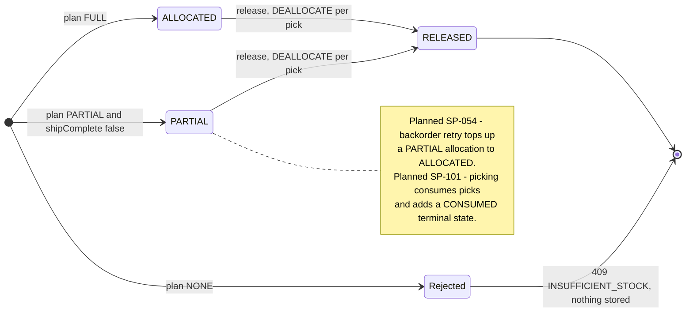

Rules: a second release returns `409 ALREADY_RELEASED` (the header row is locked `FOR UPDATE` first); the partial unique index `allocations_open_order_key` allows a new allocation for the same `order_ref` only after the previous one is `RELEASED`.

### 1.2 Outbound order (planned, SP-090, SP-091, SP-054)

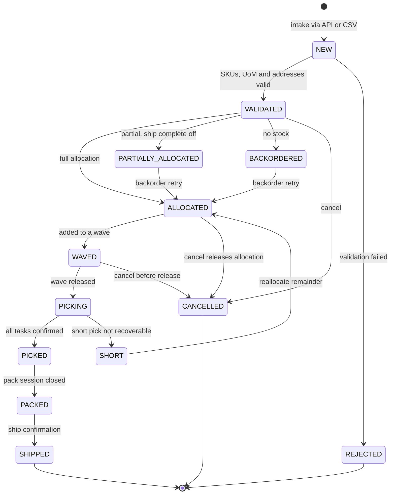

### 1.3 Wave (planned, SP-092, SP-093)

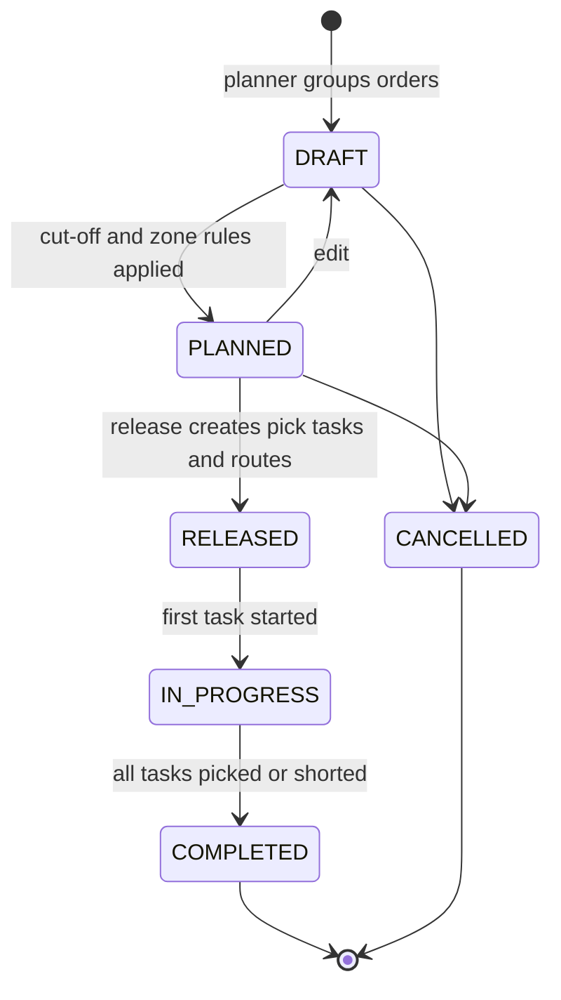

### 1.4 Pick task (planned, SP-101)

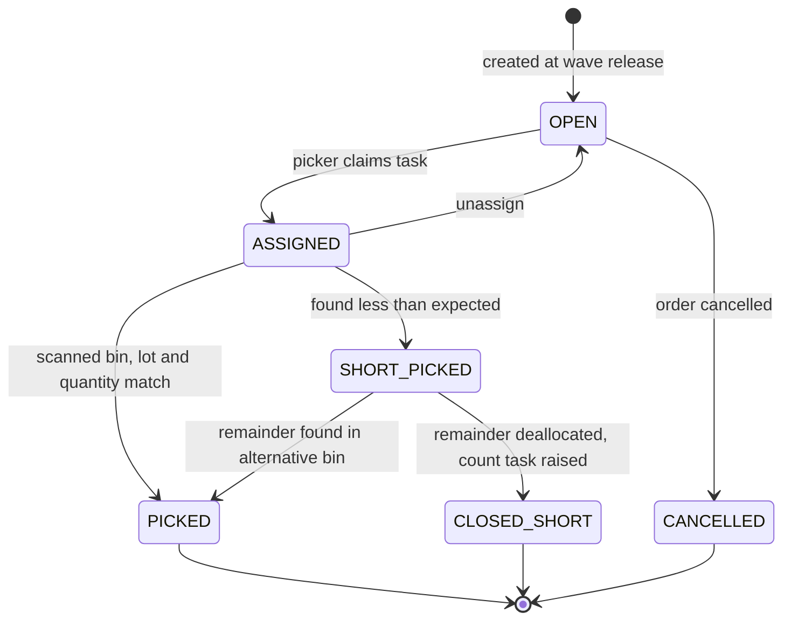

### 1.5 ASN (planned, SP-070, SP-071)

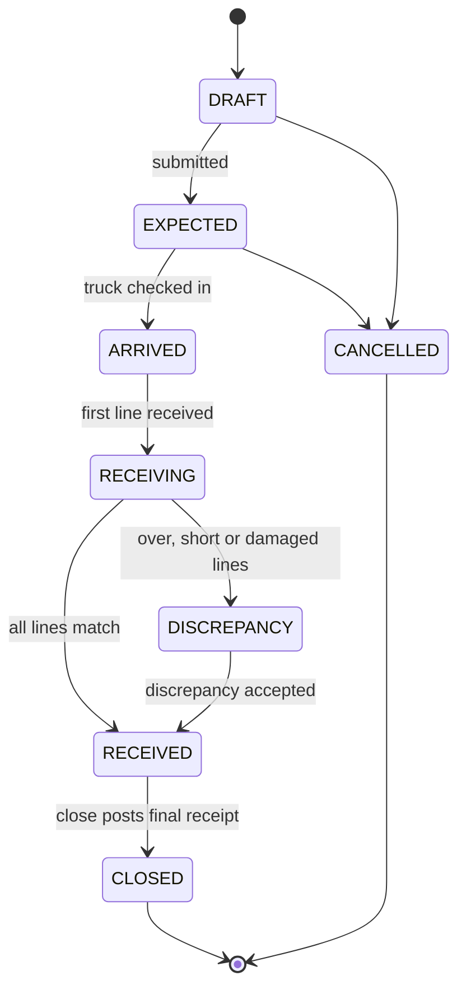

### 1.6 Cycle count (planned, SP-130, SP-131, SP-132)

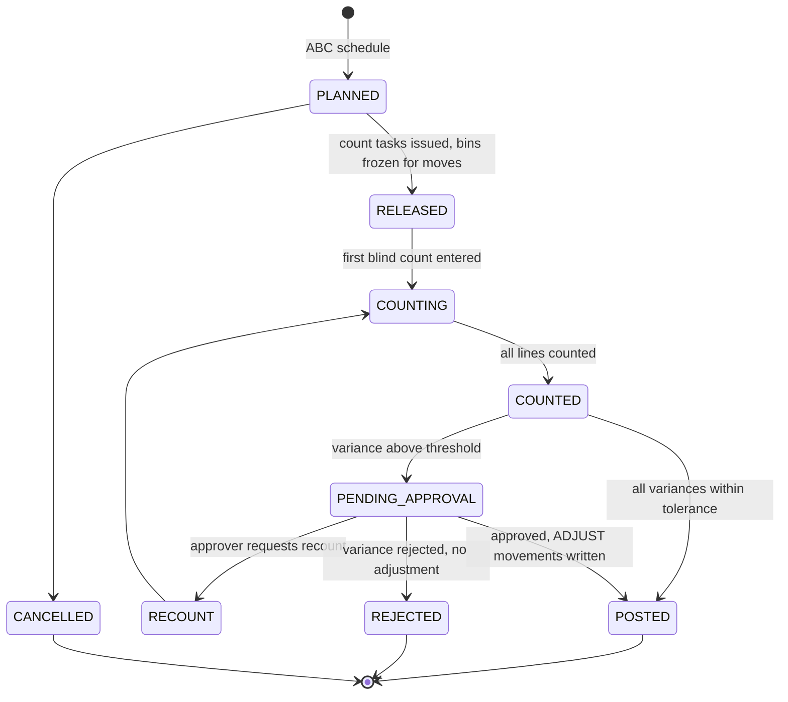

## 2. Sequence diagrams

### 2.1 Receive stock (implemented, SP-040)

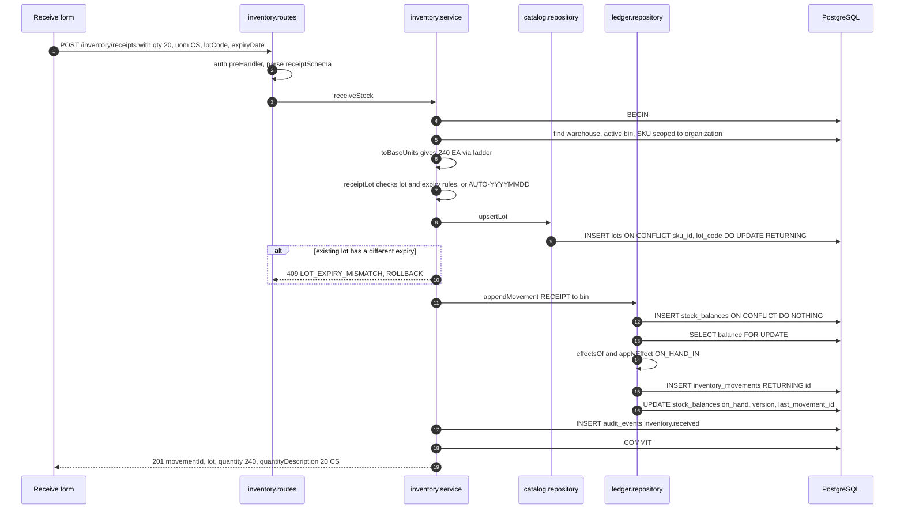

### 2.2 Move stock (implemented, SP-040)

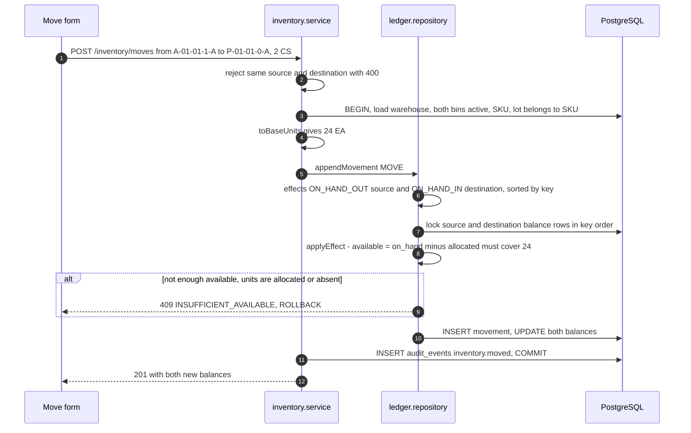

Allocated units cannot be moved: `ON_HAND_OUT` checks `available`, not `on_hand` (covered by "prevents moving allocated units out of a bin").

### 2.3 Allocate with locking, two concurrent requests (implemented, SP-051)

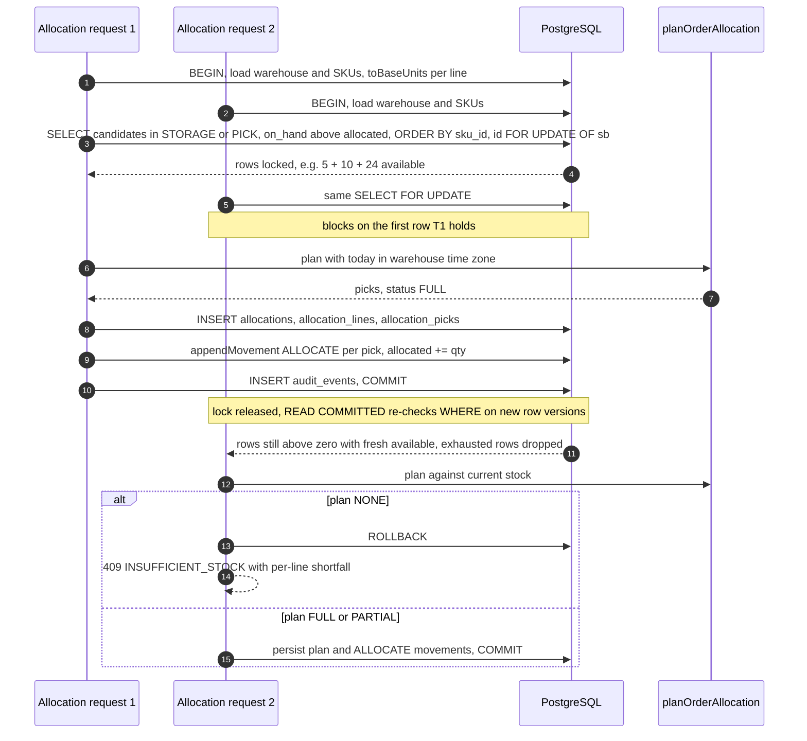

### 2.4 Release (implemented, SP-055)

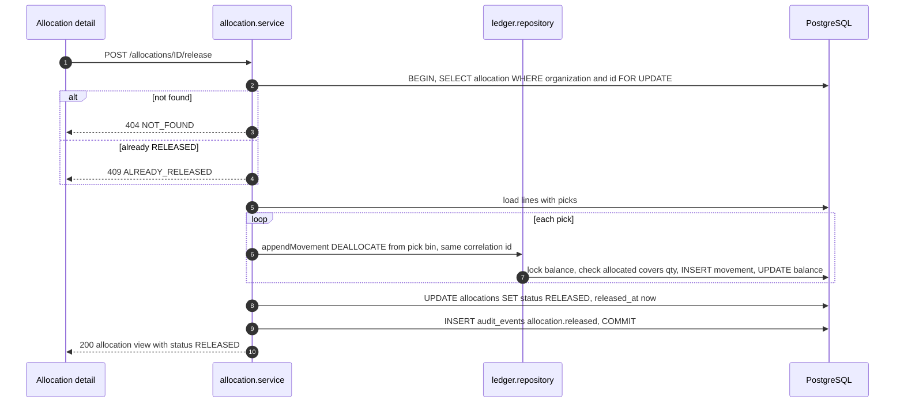

### 2.5 Projection verification (implemented, SP-041)

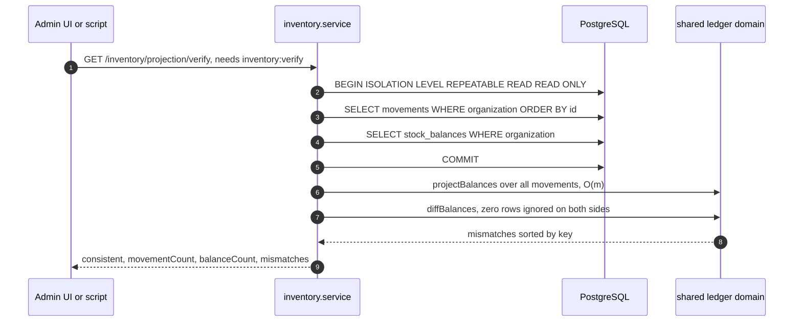

Both reads run in one `REPEATABLE READ READ ONLY` transaction on a single connection, so they see the same snapshot and concurrent writes cannot produce phantom drift; the fold itself runs after `COMMIT`, outside the transaction. The cost is still O(m) over the whole organisation's ledger; SP-044 starts the fold from the latest snapshot.

### 2.6 Login with throttles (implemented, SP-010, SP-012)

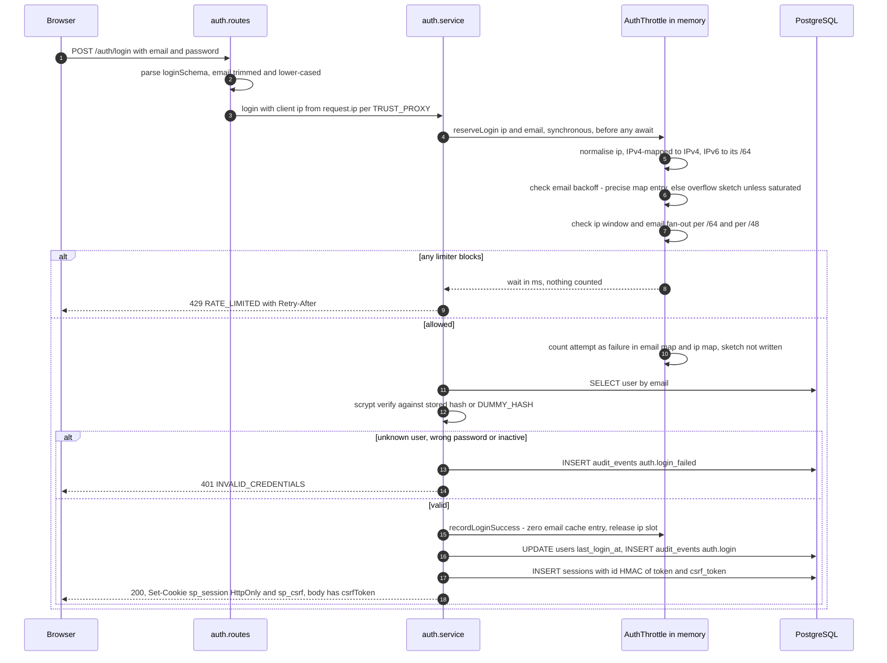

Because the reservation happens before the first `await`, twenty concurrent bad logins for one email let exactly `LOGIN_MAX_ATTEMPTS` reach password verification; the rest are rejected with 429 without touching the database.

## 3. Core algorithms

### 3.1 UoM ladder validation and conversion (`domain/uom.ts`)

- **Validation** `createUomLadder(base, levels)`: sort levels by factor (O(L log L), L <= 6 by schema), then one pass checking code format, uniqueness (Set), `2 <= factor <= MAX_QUANTITY`, and `factor % previous === 0 && factor !== previous`. O(L log L) time, O(L) space; effectively O(levels).
- **Conversion** `toBaseUnits`: one lookup and a checked multiply, O(L). `convertQuantity` converts to base and rejects remainders (`NON_INTEGRAL_CONVERSION`), O(L).
- **Breakdown** `breakdownQuantity(ladder, q)`: walk levels from largest to smallest taking `floor(remaining / factor)`. O(L). Greedy is optimal (fewest handling units) **because the ladder is nested**: every larger unit is an exact multiple of each smaller unit, so replacing k smaller units by one larger unit is always possible and never leaves an unrepresentable remainder — the same argument that makes greedy change-making optimal for canonical coin systems where each denomination divides the next.

### 3.2 Ledger fold (`domain/ledger.ts`)

- `effectsOf(movement)` validates shape (which bins must or must not be set) and returns 1 effect (`RECEIPT`, `ADJUST_*`, `ALLOCATE`, `DEALLOCATE`) or 2 effects (`MOVE`).
- `applyEffect(balance, effect)` returns a **new** balance and enforces `on_hand >= 0` and `allocated <= on_hand` via `available = on_hand - allocated`.
- `projectBalances(movements)` folds in ledger order using a local `Map` keyed by `bin|sku|lot`: **O(m)** time for m movements (each yields at most 2 effects, each O(1) amortised), **O(k)** space for k distinct keys.
- `diffBalances(expected, actual)` builds a key map of the stored rows, unions keys and sorts them for stable output: O((k + a) log(k + a)).
- Because the fold applies the same `applyEffect` used on the write path, a ledger that was valid when written is valid on replay; a replay that throws means the ledger itself is corrupt, which the trigger (ADR-0015) is designed to make impossible.

### 3.3 `planAllocation` (`domain/allocation.ts`)

Input: request (quantity, strategy, allowPartial, today, minShelfLifeDays) and n candidate rows `(bin, lot, expiry, receivedAt, available, onHold, pickSequence)`.

1. **Filter** each candidate in O(1): `NO_AVAILABLE`, `ON_HOLD`, `EXPIRED` (expiry <= today), `SHORT_SHELF_LIFE` (expiry < today + minDays). O(n).
2. **Sort** eligible candidates by `compareByStrategy` (FEFO: expiry asc, nulls last, then receivedAt; FIFO: receivedAt asc; LIFO: receivedAt desc; then lot code). O(n log n).
3. **Group** adjacent candidates that compare equal (same lot). O(n).
4. **Take from groups** in order until the remainder is 0. In each group of size g: filter covering bins and sort ascending by available — take the smallest one that covers (best fit); if none covers, sort descending by available and drain (largest first). O(g log g) per group, O(n log n) overall.
5. **Fill-or-kill**: if a shortfall remains and partial is not allowed, return `NONE` with no picks.

Total **O(n log n)** time, O(n) space. Within a lot the pick count is minimal for the "single bin if possible, else largest first" policy: if any single bin covers the remainder one pick is optimal; otherwise draining the largest bins first minimises the number of bins needed to reach a target sum (an exchange argument: swapping any chosen bin for a larger unchosen one never increases the count).

Example (FEFO, 30 EA, today 2026-11-25, min shelf life 7 days):

| Bin         | Lot    | Expiry     | Available | Outcome                                     |
| ----------- | ------ | ---------- | --------- | ------------------------------------------- |
| P-01-01-0-A | M2408Z | 2026-12-01 | 48        | excluded `SHORT_SHELF_LIFE` (6 days)        |
| QCAGE1      | M2405Q | 2026-11-28 | 24        | not a candidate: QUARANTINE zone (ADR-0013) |
| A-01-01-1-A | M2409A | 2026-12-15 | 480       | first lot by expiry, covers 30, one pick    |
| A-01-02-1-A | M2410B | 2027-01-09 | 240       | untouched                                   |

### 3.4 `planOrderAllocation` shared pool

Lines are planned in order. A `consumed` map keyed by `bin|lot` accumulates quantities taken by earlier lines; before planning line i, each candidate's `available` is reduced by `consumed`. Two lines for the same SKU therefore never promise the same units even though both see the same locked rows. With `shipComplete`, any line short makes every line `NONE`; otherwise the order status is `FULL`, `PARTIAL` or `NONE` from the totals. Complexity **O(Σ nᵢ log nᵢ)** over lines, plus O(p) map updates for p picks.

### 3.5 Default pick sequence (`domain/bin-code.ts`)

`aisle * 100000 + rackOrder * 1000 + level * 100 + position`, with `rackOrder` reversed on even aisles: O(1) per bin, giving a serpentine walk when bins are sorted by it. Used as the tie-breaker in allocation and for ordering balances and picks.

### 3.6 Pick path optimisation (planned, SP-100, ADR-0017)

Distance matrix on the aisle graph O(p²); construct with S-shape and largest-gap O(p log p) and keep the shorter; improve with 2-opt, O(p²) per pass with a bounded number of passes and a 50 ms budget per route. Deterministic; falls back to `pick_sequence` order without layout metadata (SP-023).

### 3.7 Cartonization (planned, SP-111, ADR-0018)

Partition incompatible handling classes, sort units by volume then longest edge (first-fit decreasing), place each at the first feasible extreme point of an open carton across six orientations with an AABB overlap test and weight check, open the smallest carton type that fits when needed, then try repacking into smaller cartons and merging the two least-full cartons. O(n³) worst case for n units (n <= 50 in practice) times c carton types in the improvement step.

### 3.8 Planned ledger extensions

| Movement type                         | Effects                                                                                                        | Ticket |
| ------------------------------------- | -------------------------------------------------------------------------------------------------------------- | ------ |
| `STATUS_CHANGE` (hold / release hold) | moves quantity between status buckets on the same key                                                          | SP-042 |
| Pick confirmation                     | correlated `DEALLOCATE` at source + `MOVE` source to staging location + `ALLOCATE` at staging for the shipment | SP-101 |
| `SHIP`                                | `ON_HAND_OUT` and `DEALLOCATE` from staging on ship confirmation                                               | SP-123 |
| Count variance                        | `ADJUST_IN` / `ADJUST_OUT` with reason `CORRECTION` and the count reference                                    | SP-132 |

## 4. Concurrency and consistency strategy

| Concern                              | Mechanism                                                                                                                                                                                                                                                                        | Where                                              |
| ------------------------------------ | -------------------------------------------------------------------------------------------------------------------------------------------------------------------------------------------------------------------------------------------------------------------------------- | -------------------------------------------------- |
| Isolation level                      | READ COMMITTED (PostgreSQL default) inside `withTransaction`; every command is one short transaction with no network calls inside                                                                                                                                                | `db/pool.ts`                                       |
| Oversell between allocators          | `SELECT … FOR UPDATE OF sb ORDER BY sku_id, id` locks all candidate rows before planning; blocked waiters re-evaluate `on_hand > allocated` on the committed row version (EvalPlanQual) and plan against fresh `available`                                                       | `allocation.repository.lockCandidates`, ADR-0011   |
| Lock ordering / deadlocks            | Allocators lock rows in one statement in `(sku_id, id)` order over a sorted SKU list, so allocator–allocator deadlocks cannot occur. `appendMovement` locks the 1–2 keys of a movement sorted by `bin                                                                            | sku                                                | lot`. Mixed writers (move vs allocation vs release) can still deadlock in rare interleavings; PostgreSQL aborts one victim after `deadlock_timeout`and the API maps 40P01 to`503 CONCURRENCY_RETRY`. A single global lock order for all writers is part of SP-181. | `ledger.repository.appendMovement` |
| Lost updates on the projection       | Every projection update happens after `SELECT … FOR UPDATE` of that row in the same transaction; new rows are created with `INSERT … ON CONFLICT (bin_id, sku_id, lot_id) DO NOTHING` before locking, so two first receipts into an empty position serialise on the unique index | `lockBalance`                                      |
| Invariant backstop                   | `CHECK (on_hand >= 0)`, `CHECK (allocated >= 0)`, `CONSTRAINT stock_balances_allocated_le_on_hand CHECK (allocated <= on_hand)`; violations become `409 CONSTRAINT_VIOLATION`                                                                                                    | migration 0003                                     |
| Duplicate open allocations           | Partial unique index `allocations_open_order_key (organization_id, warehouse_id, order_ref) WHERE status <> 'RELEASED'`; the losing concurrent request gets `409 ALREADY_EXISTS` and its ledger rows roll back                                                                   | migration 0003                                     |
| Double release                       | Header row `FOR UPDATE`, then status check                                                                                                                                                                                                                                       | `releaseAllocation`                                |
| Concurrent first receipt of a lot    | `INSERT … ON CONFLICT (sku_id, lot_code) DO UPDATE SET lot_code = EXCLUDED.lot_code RETURNING …` returns the existing row to the loser; differing expiry is rejected                                                                                                             | `catalog.repository.upsertLot`                     |
| Concurrent registration of one email | Unique index `users_email_key`; the loser's 23505 is swallowed and both get the same 202                                                                                                                                                                                         | `auth.service.registerOwner`                       |
| Concurrent login bursts              | Synchronous reservation in the single-threaded event loop before any `await`                                                                                                                                                                                                     | `rate-limiter.reserveLogin`                        |
| Throttle state under memory pressure | Bounded per-email Map is authoritative; only force-evicted active lock-outs spill into a fixed-size count-min sketch, read only for keys with no precise entry and ignored (with an alert) once saturated; per-process until SP-190                                              | `rate-limiter.ts`, `count-min-sketch.ts`, ADR-0020 |
| Ledger immutability                  | `BEFORE UPDATE OR DELETE` trigger                                                                                                                                                                                                                                                | ADR-0015                                           |
| Read consistency                     | Reads hit `stock_balances`, which is updated in the writer's transaction, so a client always reads its own writes after a 201                                                                                                                                                    | ADR-0009                                           |

Why not SERIALIZABLE or optimistic versions: see ADR-0011. The `version` column on `stock_balances` is incremented on each update and is available for future optimistic checks by offline clients (SP-187), but no current path relies on it.

## 5. Idempotency

| Operation                                            | Behaviour today                                                                                                                                                                  | Plan                                                                                                                                                                                                                                                                                                                                                                  |
| ---------------------------------------------------- | -------------------------------------------------------------------------------------------------------------------------------------------------------------------------------- | --------------------------------------------------------------------------------------------------------------------------------------------------------------------------------------------------------------------------------------------------------------------------------------------------------------------------------------------------------------------- |
| `POST /allocations`                                  | Natural key: a retry with the same `order_ref` while the first is open returns `409 ALREADY_EXISTS`; the client can then `GET` the list to recover the ID                        | Return the existing allocation with `200` when the request body hash matches (SP-090, order intake keys by external order reference)                                                                                                                                                                                                                                  |
| `POST /allocations/:id/release`                      | Second call returns `409 ALREADY_RELEASED`; state is unchanged, so it is safe to retry                                                                                           | Keep                                                                                                                                                                                                                                                                                                                                                                  |
| `POST /inventory/receipts`, `/moves`, `/adjustments` | **Not idempotent**: a network retry after a lost response writes a second movement. `reference` and `correlation_id` make duplicates easy to find and reverse with an adjustment | `Idempotency-Key` header stored in an `idempotency_keys` table `(organization_id, key)` with request hash, status and response body, written in the same transaction as the movement; replay returns the stored response, a different body with the same key returns `422`; keys expire after 24 h. Required for the scanner flow and offline replay (SP-072, SP-187) |
| Lot creation                                         | Idempotent via upsert                                                                                                                                                            | Keep                                                                                                                                                                                                                                                                                                                                                                  |
| ASN receipts                                         | n/a                                                                                                                                                                              | Each scan carries a client-side scan ID; `(asn_line_id, scan_id)` unique (SP-071)                                                                                                                                                                                                                                                                                     |
| Outbox delivery                                      | n/a                                                                                                                                                                              | At-least-once processing with `processed_at` and a unique `dedupe_key`; consumers idempotent (SP-173)                                                                                                                                                                                                                                                                 |
