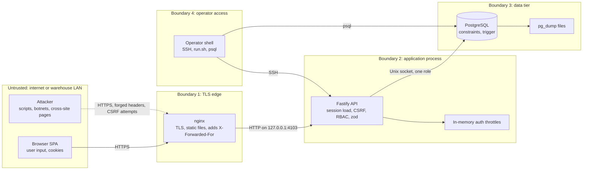

# Threat model

Scope: the StockPilot web SPA, API, PostgreSQL database and their single-host deployment (ADR-0019), as implemented in M0–M1 plus the planned controls that close known gaps. Method: data-flow decomposition, trust boundaries, STRIDE per component, mitigations mapped to code, OWASP ASVS 4.0.3 mapping, residual risks. Reviewed every milestone; full ASVS Level 2 review is SP-183.

## 1. Assets

| Asset                             | Why it matters                                                          | Where                                      |
| --------------------------------- | ----------------------------------------------------------------------- | ------------------------------------------ |
| Stock truth (ledger + projection) | Oversell, shrinkage concealment and billing disputes all start here     | `inventory_movements`, `stock_balances`    |
| Allocations                       | Promises to customers; tampering ships the wrong goods or blocks orders | `allocations*`                             |
| Credentials and sessions          | Account takeover gives the victim's permissions                         | `users.password_hash`, `sessions`, cookies |
| Tenant boundary                   | 3PL operators must never see each other's inventory or customers        | `organization_id` on every table           |
| Audit trail                       | Non-repudiation for stock adjustments and access                        | `audit_events`                             |
| Secrets                           | `SESSION_SECRET` keys session IDs; `DATABASE_URL` grants DB access      | `/etc/stockpilot/env`, `.env` (dev)        |
| Availability                      | Warehouses stop shipping when the WMS is down                           | API process, PostgreSQL                    |

## 2. Trust boundaries

| Boundary            | What crosses it                            | Primary controls                                                                                                                                                |
| ------------------- | ------------------------------------------ | --------------------------------------------------------------------------------------------------------------------------------------------------------------- |
| 1 Internet to nginx | HTTPS requests, cookies, arbitrary headers | TLS 1.2+, HSTS, request size limits; nginx overwrites `X-Forwarded-For` with `$remote_addr`                                                                     |
| 2 nginx to API      | Proxied HTTP                               | API listens on `127.0.0.1` only (`API_HOST` default); trusts exactly the configured proxy hops (`TRUST_PROXY`); session, CSRF, RBAC and zod at the handler edge |
| 3 API to PostgreSQL | SQL                                        | Parameterised queries only; constraints and trigger as last line of defence; local socket, no network listener needed                                           |
| 4 Operator access   | Shell and SQL                              | SSH keys; `db:reset` refused in production; append-only trigger also binds `psql` users                                                                         |

## 3. STRIDE per component

Legend: **I** = implemented, **P** = planned (ticket).

### 3.1 Browser SPA

| Threat                                            | STRIDE         | Mitigation                                                                                                                                                        | Status                                        |
| ------------------------------------------------- | -------------- | ----------------------------------------------------------------------------------------------------------------------------------------------------------------- | --------------------------------------------- |
| Session cookie theft by injected script           | I (disclosure) | `sp_session` is `HttpOnly`, `SameSite=Lax`, `Secure` in production; React escapes output; no `dangerouslySetInnerHTML`                                            | I                                             |
| Cross-site request forgery on mutating API calls  | T              | Double-submit: `sp_csrf` cookie echoed in `X-CSRF-Token`, compared in constant time to the session's `csrf_token`; `SameSite=Lax`                                 | I                                             |
| Login CSRF / forced registration                  | S              | Public auth routes accept only `application/json` (others get 415), which cross-site forms cannot send without a preflight the API never approves; `SameSite=Lax` | I                                             |
| Clickjacking                                      | T              | `X-Frame-Options: DENY`, CSP `frame-ancestors 'none'` on API responses; nginx sets the same for the SPA                                                           | I (API), P (nginx config in deployment guide) |
| Stale data shown after logout on shared terminals | I              | API responses `Cache-Control: no-store`; logout clears both cookies and deletes the session row                                                                   | I                                             |

### 3.2 nginx edge

| Threat                                                               | STRIDE | Mitigation                                                                                                                                                                                                                         | Status                   |
| -------------------------------------------------------------------- | ------ | ---------------------------------------------------------------------------------------------------------------------------------------------------------------------------------------------------------------------------------- | ------------------------ |
| Client spoofs its IP via `X-Forwarded-For` to evade per-IP throttles | S      | API default `TRUST_PROXY=false` (socket peer is the IP); `true` rejected at config load; **production refuses to start unless `TRUST_PROXY` is set explicitly**; behind nginx use `1` so only the nearest hop's header is honoured | I                        |
| Downgrade / sniffing                                                 | I      | TLS only, HSTS, port 80 redirects                                                                                                                                                                                                  | P (deployment guide)     |
| Volumetric request floods                                            | D      | `limit_req` per IP on `/api/`, `client_max_body_size`; API `bodyLimit` 256 KiB                                                                                                                                                     | I (API limit), P (nginx) |

### 3.3 API: authentication and sessions (`modules/auth`, `http/rate-limiter.ts`)

| Threat                                                                | STRIDE | Mitigation                                                                                                                                                                                                                                                                                                                                                                                                                                                                             | Status                                   |
| --------------------------------------------------------------------- | ------ | -------------------------------------------------------------------------------------------------------------------------------------------------------------------------------------------------------------------------------------------------------------------------------------------------------------------------------------------------------------------------------------------------------------------------------------------------------------------------------------- | ---------------------------------------- |
| Online password guessing on one account                               | S      | Per-email progressive backoff: 5 free attempts, then 30 s doubling to a 15-min cap; failures decay after 1 h                                                                                                                                                                                                                                                                                                                                                                           | I                                        |
| Password spraying across many accounts                                | S      | Per-normalised-IP window: 50 attempts per 15 min across all emails, not reset by a success; per-IP cap of 20 **distinct emails** per window, and 80 per IPv6 /48                                                                                                                                                                                                                                                                                                                       | I                                        |
| Concurrent burst slips past the check before failures are counted     | S      | Attempts are **reserved synchronously before any `await`** (check-and-count in one event-loop turn); a success hands the reservation back. Test: 20 parallel bad logins, exactly `LOGIN_MAX_ATTEMPTS` reach password verification                                                                                                                                                                                                                                                      | I                                        |
| IPv6 address rotation within one allocation                           | S      | IPs normalised: IPv4-mapped to IPv4, IPv6 reduced to its /64                                                                                                                                                                                                                                                                                                                                                                                                                           | I                                        |
| Memory exhaustion by flooding throttle keys                           | D      | Fixed memory: per-key Maps capped at 100 000 entries each, sweeping lapsed entries and then evicting least-time-left with a `throttle_store_full` warning; plus one fixed overflow count-min sketch (4 x 16 384 cells, about 1 MiB) (ADR-0020)                                                                                                                                                                                                                                         | I                                        |
| Flooding the maps to evict and thereby clear a victim's lock-out      | S      | A force-evicted **active** per-email entry is absorbed into the sketch (keyed by HMAC of the email, so collisions cannot be targeted); the sketch is read only for keys with no precise entry and never under-counts, so the lock-out returns at full strength. Ordinary failures never write to the sketch, so spread failures cannot lock out untouched emails, and a successful login's zero entry always wins. New keys are never refused, so a flood cannot block unrelated users | I                                        |
| Throttle bypass by running several API instances, or reset by restart | S, D   | Counters are in process memory, correct only for **one** instance. **They must move to PostgreSQL (`auth_throttle_counters`, shared throttle store SP-190, part of the SP-183 hardening) before more than one API instance runs.** Deployment guide and ADR-0006 state this as a precondition for scaling out                                                                                                                                                                          | P (SP-183, SP-190)                       |
| Account enumeration via login                                         | I      | Same 401 `INVALID_CREDENTIALS` for unknown, wrong-password and inactive; scrypt verify against `DUMMY_HASH` for unknown emails to equalise timing                                                                                                                                                                                                                                                                                                                                      | I                                        |
| Account enumeration via registration                                  | I      | Always `202 accepted` with the same message; no session issued; password hashed before the lookup; duplicates only audited; unique-violation race answered identically                                                                                                                                                                                                                                                                                                                 | I                                        |
| Registering with an email the user does not own                       | S      | Email verification via the **local outbox** (no email provider): verification token stored hashed in `auth_tokens`, message written to `outbox_messages` and delivered in-app or via a development mailbox page; workspace activated on verification                                                                                                                                                                                                                                   | P (SP-009, SP-173)                       |
| Offline cracking after a DB leak                                      | I      | scrypt N=2^15, r=8, p=1, 16-byte salt, 64-byte key; parameters stored per hash for future upgrade                                                                                                                                                                                                                                                                                                                                                                                      | I                                        |
| Session replay from a DB leak                                         | S      | DB stores `HMAC-SHA256(SESSION_SECRET, token)`, not the token                                                                                                                                                                                                                                                                                                                                                                                                                          | I                                        |
| Session fixation                                                      | S      | New random 32-byte token issued at every login; no pre-login session exists                                                                                                                                                                                                                                                                                                                                                                                                            | I                                        |
| Long-lived stolen session                                             | S      | 12 h TTL (configurable 1–720 h); server-side delete on logout; deactivated users rejected on next request; idle timeout and "sign out everywhere"                                                                                                                                                                                                                                                                                                                                      | I (TTL, revoke), P (SP-015 session list) |
| Mass workspace creation                                               | D      | Registration limiter: 10 per normalised IP per hour                                                                                                                                                                                                                                                                                                                                                                                                                                    | I                                        |
| Per-email lock-out used to deny a known user                          | D      | Accepted residual (cap 15 min); per-email-per-IP keying evaluated in SP-183                                                                                                                                                                                                                                                                                                                                                                                                            | Residual                                 |

### 3.4 API: authorisation and business modules

| Threat                                                                        | STRIDE | Mitigation                                                                                                                                                                                   | Status                                         |
| ----------------------------------------------------------------------------- | ------ | -------------------------------------------------------------------------------------------------------------------------------------------------------------------------------------------- | ---------------------------------------------- |
| Horizontal privilege escalation across tenants (IDOR with a foreign UUID)     | E, I   | `organization_id` from the session in every repository query; foreign IDs return 404; composite FKs for zones/bins; ledger writes validate warehouse, bin, SKU and lot against the org first | I; cross-tenant endpoint sweep test P (SP-183) |
| Vertical escalation (operator adjusts stock, viewer allocates)                | E      | Route-level `config.permission`, `hasPermission(role, …)`; handlers never check roles                                                                                                        | I                                              |
| Unauthenticated access to pending endpoints                                   | I      | Pending routes require `authenticated` before returning 501                                                                                                                                  | I                                              |
| Oversell via concurrent allocation                                            | T      | Ordered `FOR UPDATE` locks, pure-code invariants, `CHECK (allocated <= on_hand)`                                                                                                             | I                                              |
| Tampering with history to hide shrinkage                                      | T, R   | Append-only trigger on `inventory_movements`; corrections only via reason-coded adjustments; audit event per change with actor and request ID                                                | I                                              |
| Large unapproved adjustments by a single manager                              | T, R   | Threshold-based approval workflow                                                                                                                                                            | P (SP-045)                                     |
| Injection (SQL)                                                               | T      | Parameterised `pg` queries only; no string-built SQL from input (dynamic fragments are constants such as `FOR UPDATE`)                                                                       | I                                              |
| Malformed or oversized input crashing handlers                                | D, T   | zod schemas with bounds (quantities <= 10^12, lists <= 200 lines, strings <= 240); 256 KiB body limit; JSON only                                                                             | I                                              |
| Expensive admin operation as DoS (`projection/verify` folds the whole ledger) | D      | Restricted to `inventory:verify` (admin, owner); snapshots bound cost                                                                                                                        | I (permission), P (SP-044)                     |
| Error responses leaking internals                                             | I      | Central handler returns generic 500 message; details only for 4xx; stack traces only in server logs                                                                                          | I                                              |
| Repudiation of actions                                                        | R      | `audit_events` with actor, action, entity, request ID; movements carry `actor_user_id` and `correlation_id`                                                                                  | I                                              |

### 3.5 PostgreSQL and backups

| Threat                                                  | STRIDE | Mitigation                                                                                                           | Status               |
| ------------------------------------------------------- | ------ | -------------------------------------------------------------------------------------------------------------------- | -------------------- |
| Ad-hoc `UPDATE`/`DELETE` on the ledger                  | T      | Trigger raises `insufficient_privilege` for any client                                                               | I                    |
| `TRUNCATE` or privileged misuse by the application role | T, E   | Split migration owner and runtime role; runtime role lacks `UPDATE`/`DELETE`/`TRUNCATE` on the ledger and DDL rights | P (SP-183)           |
| Network exposure of the database                        | I      | Listen on Unix socket / localhost only; `pg_hba.conf` peer or scram auth                                             | P (deployment guide) |
| Backup theft                                            | I      | Backups owned by `postgres`, mode 0600, optional `gpg` encryption to an off-host key                                 | P (SP-182)           |
| Data loss                                               | D      | Nightly `pg_dump -Fc`, restore drills, verify endpoint after restore                                                 | P (SP-182)           |

### 3.6 Configuration, logging and supply chain

| Threat                                   | STRIDE | Mitigation                                                                                                        | Status                              |
| ---------------------------------------- | ------ | ----------------------------------------------------------------------------------------------------------------- | ----------------------------------- |
| Weak or placeholder secret in production | S      | zod: `SESSION_SECRET` >= 32 chars; placeholder rejected in production; `run.sh` generates a random secret for dev | I                                   |
| Unsafe proxy trust by default            | S      | `TRUST_PROXY` must be explicit in production; `true` rejected                                                     | I                                   |
| Secrets or tokens in logs                | I      | pino redacts `cookie`, `x-csrf-token`, `set-cookie`; tokens never logged; request bodies not logged               | I                                   |
| Log injection via request ID             | T      | Incoming `X-Request-Id` accepted only if it matches `^[A-Za-z0-9._-]{8,64}$`, else replaced                       | I                                   |
| Malicious or vulnerable dependency       | T, E   | Lean dependency list; `package-lock.json`; `npm ci` in CI; `npm audit` gate                                       | I (lockfile), P (audit gate SP-183) |

## 4. OWASP ASVS 4.0.3 mapping (Level 2 target)

| ASVS            | Requirement (abridged)                             | StockPilot control                                                           | Status                                             |
| --------------- | -------------------------------------------------- | ---------------------------------------------------------------------------- | -------------------------------------------------- |
| V1.4.1          | Access control enforced at a trusted service layer | Fastify preHandler + `config.permission`                                     | Met                                                |
| V2.1.1          | Passwords >= 12 characters                         | `passwordSchema` min 12, max 200                                             | Met                                                |
| V2.2.1          | Anti-automation against credential attacks         | Per-email backoff, per-IP window, email fan-out cap, synchronous reservation | Met (single instance); multi-instance needs SP-190 |
| V2.2.3          | Notify users of security events                    | Login and new-session notifications via local outbox                         | Planned (SP-173)                                   |
| V2.4.1          | Passwords stored with an approved KDF              | scrypt N=2^15, r=8, p=1                                                      | Met                                                |
| V2.4.2          | Unique salt per credential                         | 16-byte random salt                                                          | Met                                                |
| V2.5.1 / V2.5.2 | Secure recovery, no hints                          | Password reset via local outbox, hashed single-use token                     | Planned (SP-017)                                   |
| V2.5.4          | No shared or default accounts                      | Demo users only in seed; seed is a dev tool                                  | Met                                                |
| V3.2.1          | New session token on authentication                | Fresh token per login                                                        | Met                                                |
| V3.2.2          | >= 64 bits of entropy                              | 256-bit random tokens                                                        | Met                                                |
| V3.2.3          | Tokens stored only in secure browser storage       | HttpOnly cookie                                                              | Met                                                |
| V3.3.1          | Logout invalidates the session                     | Row deleted, cookies cleared                                                 | Met                                                |
| V3.3.2          | Absolute / idle timeout                            | 12 h absolute; idle timeout                                                  | Absolute met, idle planned (SP-183)                |
| V3.4.1–V3.4.3   | Cookie `Secure`, `HttpOnly`, `SameSite`            | All set (Secure in production)                                               | Met                                                |
| V3.5.3          | Stateless tokens protected                         | Not used (stateful sessions)                                                 | N/A                                                |
| V4.1.3          | Least privilege                                    | Five roles, permission lists                                                 | Met                                                |
| V4.2.1          | Protection against IDOR                            | `organization_id` scoping, 404 on foreign IDs                                | Met; sweep test planned (SP-183)                   |
| V4.2.2          | Anti-CSRF                                          | Double-submit token on all mutating protected routes                         | Met                                                |
| V4.3.1          | Admin interfaces protected                         | `inventory:verify`, `users:manage` admin-only                                | Met                                                |
| V5.1.3          | Positive input validation                          | zod schemas on every body, query, params                                     | Met                                                |
| V5.3.4          | Parameterised queries                              | `pg` parameters everywhere                                                   | Met                                                |
| V7.1.1          | No credentials or session tokens in logs           | pino redaction, tokens never logged                                          | Met                                                |
| V7.2.1          | Authentication decisions logged                    | `auth.login`, `auth.login_failed`, `auth.register_duplicate` audit events    | Met                                                |
| V7.4.1          | Generic error messages                             | Central handler, 500 generic                                                 | Met                                                |
| V8.3.4          | Sensitive data identified and protected            | Session IDs keyed by HMAC; no PII beyond name and email                      | Met                                                |
| V9.1.1          | TLS for all client connections                     | nginx TLS                                                                    | Planned (deployment guide)                         |
| V11.1.4         | Anti-automation on business functions              | Allocation and receipt rate limits                                           | Planned (SP-183)                                   |
| V13.1.3         | API URLs do not expose sensitive data              | IDs only in paths; no tokens in query strings                                | Met                                                |
| V13.2.5         | Content-Type validated                             | JSON only, 415 otherwise                                                     | Met                                                |
| V14.2.1         | Components up to date, vulnerability check         | `npm audit` gate                                                             | Planned (SP-183)                                   |
| V14.4.1–V14.4.7 | Security headers                                   | `nosniff`, `DENY`, CSP, `no-referrer`, COOP, `no-store`                      | Met for API; SPA headers via nginx planned         |

## 5. Residual risks

| ID  | Risk                                                                                                                                                               | Likelihood                    | Impact | Treatment                                                                                                                                                           |
| --- | ------------------------------------------------------------------------------------------------------------------------------------------------------------------ | ----------------------------- | ------ | ------------------------------------------------------------------------------------------------------------------------------------------------------------------- |
| R1  | Running a second API instance before SP-190 multiplies the login attempt budget and splits counters                                                                | Low (documented precondition) | High   | Hard rule in ADR-0006, ADR-0020, deployment guide and `rate-limiter.ts`; SP-190 moves all throttle state to PostgreSQL                                              |
| R2  | Throttle state (maps and sketch) is per process and resets on restart                                                                                              | Medium                        | Low    | Accepted for single instance; fixed by SP-190                                                                                                                       |
| R2a | An email with no precise map entry whose sketch cells collide in every row with absorbed lock-outs may be over-throttled for at most one login window              | Low                           | Low    | Accepted narrow fail-closed behaviour on one bucket (ADR-0020); HMAC keying prevents targeting; SP-190 removes the approximation                                    |
| R2c | Sketch saturation (any row over 50% occupied, roughly 8 000 forced active-lock-out evictions per generation): the sketch is ignored and evicted lock-outs are lost | Low                           | Medium | Deliberate fail-open for availability; `throttle_sketch_saturated` alert logged and counter incremented for monitoring (SP-180); SP-190 removes the in-memory limit |
| R2b | Per-IP and per-prefix caches can still evict under extreme key pressure, temporarily weakening the spraying guard while per-email lock-outs hold                   | Low                           | Medium | `throttle_store_full` warning for alerting (SP-180); nginx `limit_req`; SP-190                                                                                      |
| R3  | Registration before email verification lets someone create a workspace with an address they do not own (no access to an existing account is gained)                | Medium                        | Low    | SP-009 email verification via local outbox                                                                                                                          |
| R4  | Targeted 15-minute lock-out of a known user via the email backoff                                                                                                  | Medium                        | Medium | Accepted; SP-183 evaluates per-email-per-IP keying and admin unlock                                                                                                 |
| R5  | A future query missing the `organization_id` predicate leaks cross-tenant data                                                                                     | Low                           | High   | Repository pattern, review checklist, SP-183 cross-tenant sweep test; RLS re-evaluated                                                                              |
| R6  | Same database role for migrations and runtime allows `TRUNCATE` of the ledger if the API is compromised                                                            | Low                           | High   | SP-183 role split; backups (SP-182)                                                                                                                                 |
| R7  | Deadlocks between mixed writers surface as `503 CONCURRENCY_RETRY`; a client blindly retrying a non-idempotent receipt could double-post                           | Low                           | Medium | Unified lock order (SP-181); idempotency keys (SP-187); `correlation_id` makes duplicates traceable and reversible                                                  |
| R8  | No business-level rate limits on allocation or receipt endpoints                                                                                                   | Low                           | Medium | nginx `limit_req` in deployment guide; app-level limits in SP-183                                                                                                   |
| R9  | Large adjustments require only `inventory:adjust`                                                                                                                  | Medium                        | Medium | SP-045 approval thresholds; audit trail already records actor and reason                                                                                            |
| R10 | Backups unencrypted at rest on the same host                                                                                                                       | Medium                        | High   | SP-182 encrypted off-host copies                                                                                                                                    |
